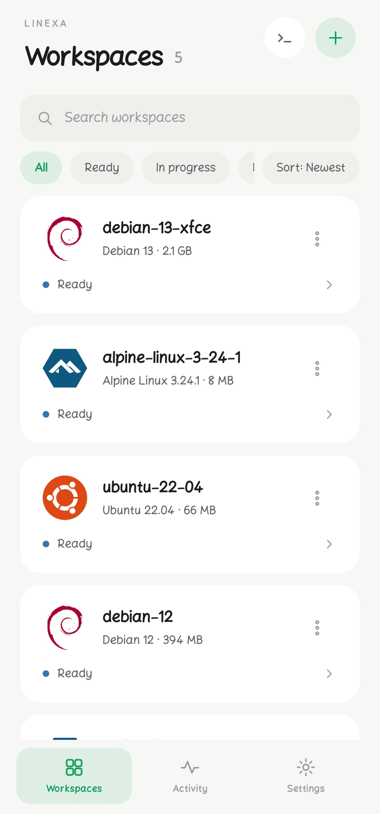
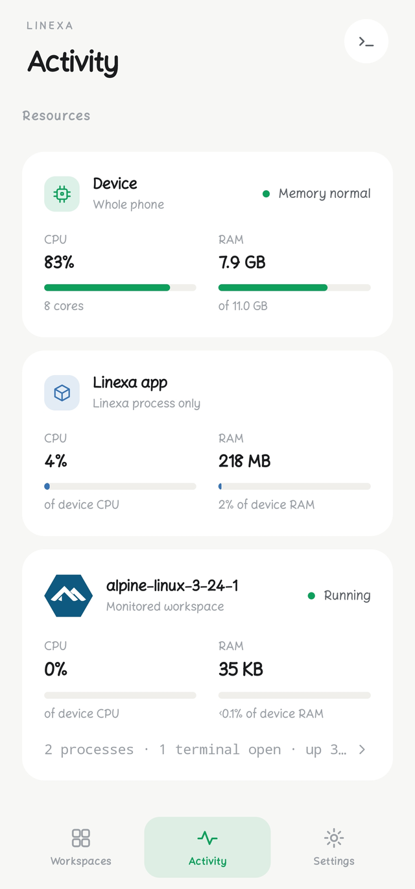
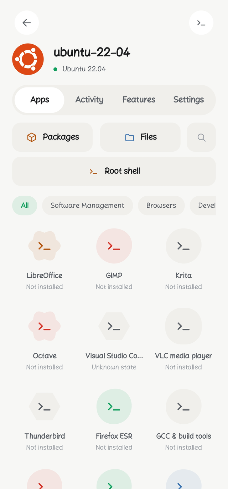
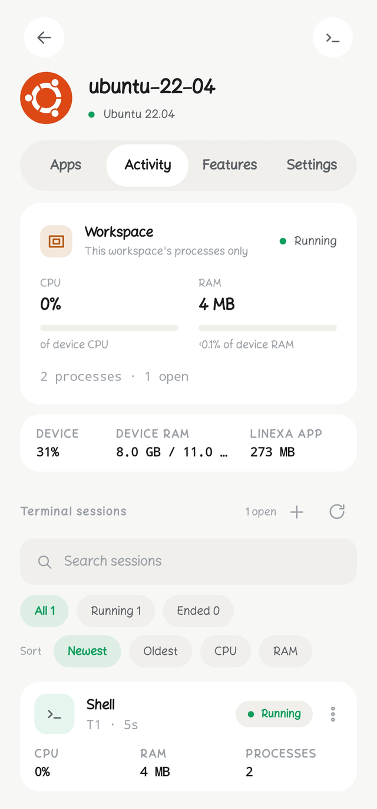
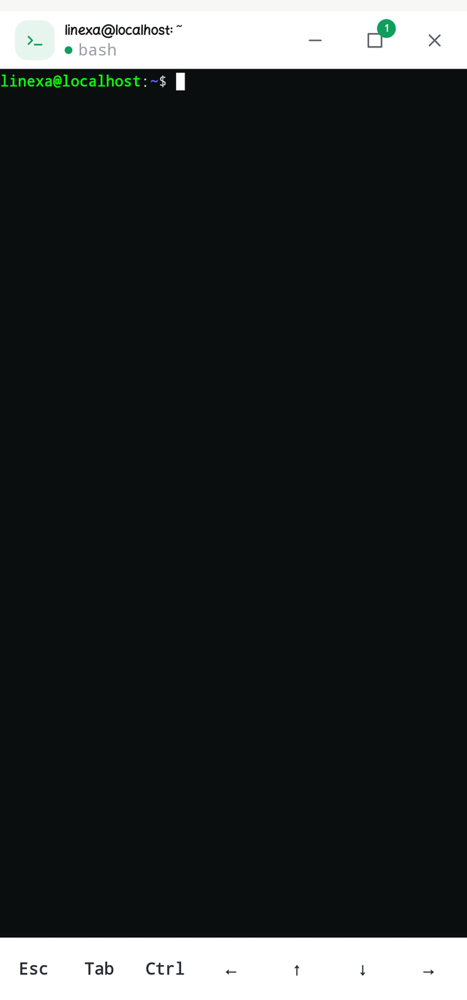
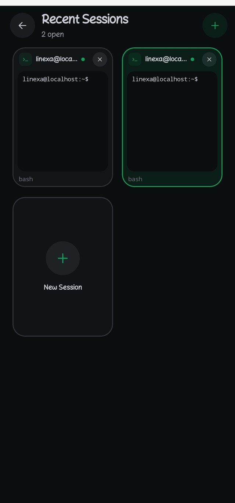
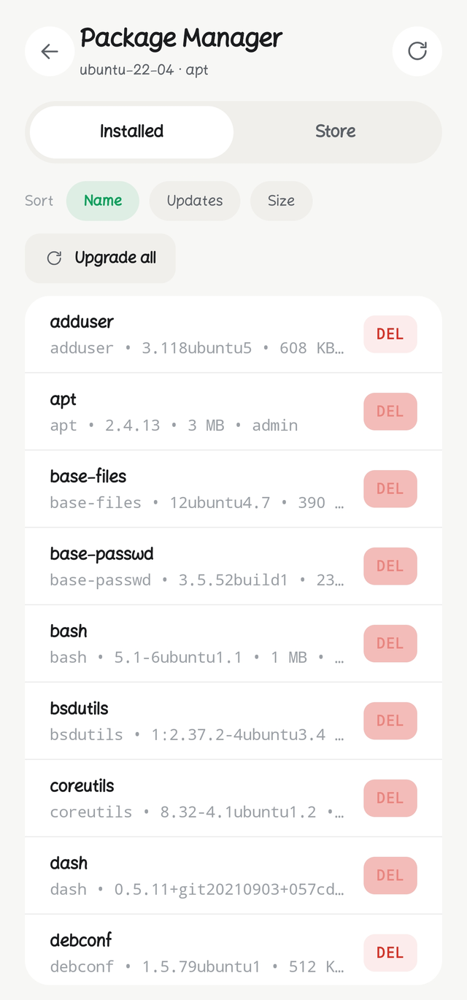
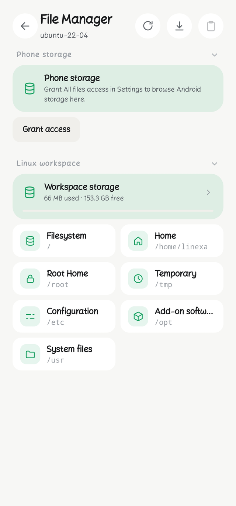

<p align="center">
  
</p>

<h1 align="center">Linexa</h1>

<p align="center">
  <strong>Linux workspaces on Android. No root required.</strong><br>
  <em>Create, install, and manage Linux environments directly on your device.</em>
</p>

<p align="center">
  <a href="https://github.com/ForExample25/Linexa/releases/tag/v0.1.0-beta"></a>
  
  
  <a href="./LICENSE"></a>
</p>

<p align="center">
  <a href="#english">English</a> ·
  <a href="#فارسی">فارسی</a> ·
  <a href="https://github.com/ForExample25/Linexa/releases/tag/v0.1.0-beta">Download</a> ·
  <a href="./docs/README.md">Documentation</a>
</p>

---

## English

Linexa brings Linux environments to Android. It creates isolated Linux
workspaces on top of PRoot, so you can install a root filesystem, open a real
terminal, manage files and packages, and run a graphical desktop without root
access or a separate Linux device.

> **Beta status.** `0.1.0-beta` is an early public release. Interfaces,
> supported guests, and device behaviour may change between releases. Back up
> important workspace data before upgrading.

### Features

| 🐧 **Linux workspaces** | 📦 **RootFS installer** | 💻 **Real terminal** |
|:---|:---|:---|
| Create multiple isolated Linux workspaces and switch between them. Each workspace keeps its own root filesystem, sessions, and settings. | Install from a local `.tar.gz`, `.tar.xz`, or `.tar.zst` archive, or download Alpine, Ubuntu, Arch Linux ARM, Debian, or Fedora from the built-in catalog. | A persistent PTY terminal with ANSI/cursor rendering, scrollback, selection, copy/paste, pinch-to-zoom, and an extra-keys row. |

| 🖥️ **Desktop access** | 📦 **Package manager** | 📁 **File manager** |
|:---|:---|:---|
| Open a graphical desktop through the built-in VNC client or a WebView pointed at a guest web server. VNC mode needs an `Xvnc` binary in the guest; Debian and Ubuntu have a guided installer. | Search, install, update, and remove packages through apt, pacman, apk, dnf, or zypper, with a per-workspace operation queue. | Browse, copy, rename, delete, import, and edit files, with syntax highlighting and a Storage Access Framework provider. |

| 🧭 **Sessions and tasks** | 🌐 **Workspace networking** | 🔒 **Local-first and transparent** |
|:---|:---|:---|
| Manage multiple terminal sessions per workspace, keep long-running work in the background, and inspect or stop workspace processes with the task manager. | Configure per-workspace DNS, `/etc/hosts`, package mirrors, and a RootFS download mirror. Checksums still come from the official source. | Workspace metadata lives in Room on your device. No account, no cloud dependency, and no root. Bundled third-party programs stay under their own licenses in **Settings → About**. |

### Screenshots

<table width="100%">
  <tr>
    <td width="25%" align="center" valign="top">
      <a href="docs/screenshots/home.png"></a><br>
      <sub><b>Home</b><br>Workspaces and quick actions at a glance.</sub>
    </td>
    <td width="25%" align="center" valign="top">
      <a href="docs/screenshots/activity.png"></a><br>
      <sub><b>Activity</b><br>Runtime activity and resource overview.</sub>
    </td>
    <td width="25%" align="center" valign="top">
      <a href="docs/screenshots/workspace.png"></a><br>
      <sub><b>Workspace</b><br>Terminal, desktop, and sessions in one place.</sub>
    </td>
    <td width="25%" align="center" valign="top">
      <a href="docs/screenshots/sessions.png"></a><br>
      <sub><b>Sessions</b><br>Open and ended sessions with search and filters.</sub>
    </td>
  </tr>
  <tr>
    <td width="25%" align="center" valign="top">
      <a href="docs/screenshots/terminal.png"></a><br>
      <sub><b>Terminal</b><br>A full PTY terminal with extra keys.</sub>
    </td>
    <td width="25%" align="center" valign="top">
      <a href="docs/screenshots/recent-sessions.png"></a><br>
      <sub><b>Recent sessions</b><br>Jump back into recent terminal sessions.</sub>
    </td>
    <td width="25%" align="center" valign="top">
      <a href="docs/screenshots/package-manager.png"></a><br>
      <sub><b>Package manager</b><br>Search and install packages from distro repositories.</sub>
    </td>
    <td width="25%" align="center" valign="top">
      <a href="docs/screenshots/file-manager.png"></a><br>
      <sub><b>File manager</b><br>Browse and edit workspace files.</sub>
    </td>
  </tr>
</table>

### Installation

1. Download the signed `app-release.apk` from the
   [v0.1.0-beta release](https://github.com/ForExample25/Linexa/releases/tag/v0.1.0-beta).
2. Allow installation from your browser or file manager when Android asks.
3. Open the APK and install it.
4. Launch Linexa, choose **Add a Workspace**, then import a RootFS archive or
   download a distribution.

**Requirements:** Android 9 (API 28) or newer, an `arm64-v8a` or
`armeabi-v7a` device, and about 60 MB for the APK plus space for your
workspaces. The release page publishes the APK SHA-256 checksum and signing
certificate fingerprint.

Linexa does not require root. PRoot provides a user-space guest environment;
the Android app itself runs with ordinary app permissions.

### Build from source

The Gradle wrapper is committed. You need JDK 17, Android SDK platform 34, and
build-tools 34.0.0.

```bash
printf 'sdk.dir=%s\n' "$ANDROID_HOME" > local.properties
./gradlew :app:testDebugUnitTest
./gradlew :app:assembleDebug
./gradlew :app:assembleRelease   # requires signing properties in local.properties
```

Release builds read `signing.storeFile`, `signing.storePassword`,
`signing.keyAlias`, and `signing.keyPassword` from `local.properties`. The task
fails when signing material is missing; it never silently emits an unsigned
release APK. See [`docs/engineering/BUILD_AND_DEVELOPMENT.md`](./docs/engineering/BUILD_AND_DEVELOPMENT.md)
for the full toolchain notes.

### License

Copyright (C) 2026 ForExample25

Linexa is free software: you can redistribute it and/or modify it under the
terms of the **GNU General Public License, version 3 only**
(`GPL-3.0-only`). The full license text is in [`LICENSE`](./LICENSE), a
verbatim copy of <https://www.gnu.org/licenses/gpl-3.0.txt>.

This program is distributed in the hope that it will be useful, but WITHOUT
ANY WARRANTY; without even the implied warranty of MERCHANTABILITY or FITNESS
FOR A PARTICULAR PURPOSE. See the GNU General Public License for more details.

**Why GPL-3.0-only.** The license was compelled by the code Linexa was built
from when the choice was made: the terminal emulator Linexa linked against
([`terminal-lib`](https://github.com/tiny-computer/terminal-lib)) was
`GPL-3.0-only`, which made a GPLv3-compatible license binding rather than
optional. On **2026-08-29 that dependency was removed** — the terminal stack is
now the vendored **Apache-2.0 Termux terminal modules**
(`terminal-emulator` and `terminal-view` from termux/termux-app, see
[`terminal-emulator/PROVENANCE.md`](./terminal-emulator/PROVENANCE.md)) — but
Linexa remains copyleft: the grant was already published, and the still-bundled
runtime includes copyleft components (PRoot `GPL-2.0-or-later`, BusyBox
`GPL-2.0-only`, GNU tar `GPL-3.0-or-later`), so a combined distribution is
**effectively** GPLv3 regardless. Relicensing a work back out of the GPL is not
something its own history can undo.

Linexa's `GPL-3.0-only` covers Linexa's own source, not the vendored programs.
Each third-party component remains under its **own** license. The complete
inventory — versions, copyright notices, license texts, and the written offer
for corresponding source — is in
[`THIRD_PARTY_NOTICES.md`](./THIRD_PARTY_NOTICES.md). The same information is
available in the app under **Settings → About → Open source licenses**, where
every bundled program is listed with its license and a source link.

Copies published before 2026-11-14 were offered under `GPL-3.0-or-later`; that
grant remains available for those copies. This release and all later releases
state `GPL-3.0-only` for Linexa's own source.

### Documentation and links

- [GitHub repository](https://github.com/ForExample25/Linexa)
- [Releases](https://github.com/ForExample25/Linexa/releases)
- [Issue tracker](https://github.com/ForExample25/Linexa/issues)
- [Documentation index](./docs/README.md)
- [System architecture](./docs/architecture/SYSTEM_ARCHITECTURE.md)
- [Third-party notices](./THIRD_PARTY_NOTICES.md)
- [Native binary manifest](./app/src/main/jniLibs/BINARY-MANIFEST.md)
- [PRoot build notes](./app/src/main/jniLibs/proot-build/BUILD-NOTES.md)

### Security and contributing

No signing credentials, keystores, or API keys are committed.
`local.properties` and `keystore/` are gitignored and must stay that way. To
report a vulnerability, open a private security advisory on GitHub; do not put
secrets or personal data in a public issue.

Before opening a change, run `./gradlew :app:testDebugUnitTest`. If you add or
remove a native binary or dependency, update `AttributionCatalog.kt`,
`THIRD_PARTY_NOTICES.md`, and `app/src/main/jniLibs/BINARY-MANIFEST.md`. Room
schema changes must follow [`docs/ROOM_MIGRATIONS.md`](./docs/ROOM_MIGRATIONS.md)
and include the exported schema JSON.

---

## فارسی

<p dir="rtl" align="right">
Linexa محیط‌های لینوکس را به اندروید می‌آورد. این برنامه با استفاده از PRoot محیط‌های کاری لینوکس را به‌صورت ایزوله روی دستگاه شما ایجاد می‌کند؛ بنابراین می‌توانید بدون دسترسی روت یا نیاز به یک دستگاه لینوکس جداگانه، یک سیستم‌فایل ریشه نصب کنید، ترمینال واقعی باز کنید، فایل‌ها و بسته‌ها را مدیریت کنید و یک میزکار گرافیکی اجرا کنید.
</p>

<p dir="rtl" align="right">
<strong>وضعیت بتا:</strong> نسخه <code>0.1.0-beta</code> یک انتشار عمومی اولیه است. رابط کاربری، توزیع‌های پشتیبانی‌شده و رفتار برنامه ممکن است بین نسخه‌ها تغییر کند. پیش از به‌روزرسانی از داده‌های مهم فضای کاری نسخه پشتیبان بگیرید.
</p>

### ویژگی‌ها

| 🐧 **فضاهای کاری لینوکس** | 📦 **نصب‌کننده RootFS** | 💻 **ترمینال واقعی** |
|:---|:---|:---|
| چند فضای کاری لینوکس ایزوله بسازید و بین آن‌ها جابه‌جا شوید. هر فضا سیستم‌فایل ریشه، نشست‌ها و تنظیمات مستقل خود را دارد. | از آرشیو محلی `.tar.gz`، `.tar.xz` یا `.tar.zst` نصب کنید، یا Alpine، Ubuntu، Arch Linux ARM، Debian یا Fedora را از فهرست داخلی دانلود کنید. | ترمینال PTY پایدار با رندر ANSI و مکان‌نما، اسکرول‌بک، انتخاب متن، کپی/چسباندن، بزرگ‌نمایی با دو انگشت و ردیف کلیدهای اضافی. |

| 🖥️ **دسترسی به میزکار** | 📦 **مدیر بسته** | 📁 **مدیر فایل** |
|:---|:---|:---|
| میزکار گرافیکی را از طریق کلاینت VNC داخلی یا WebView متصل به سرور وب مهمان باز کنید. حالت VNC به فایل اجرایی `Xvnc` در مهمان نیاز دارد؛ Debian و Ubuntu نصب‌کننده راهنما دارند. | بسته‌ها را با apt، pacman، apk، dnf یا zypper جست‌وجو، نصب، به‌روزرسانی و حذف کنید؛ هر فضا صف عملیات مستقل دارد. | فایل‌ها را مرور، کپی، تغییر نام، حذف، وارد و ویرایش کنید؛ با برجسته‌سازی نحو و ارائه‌دهنده Storage Access Framework. |

| 🧭 **نشست‌ها و فرایندها** | 🌐 **شبکه فضای کاری** | 🔒 **محلی و شفاف** |
|:---|:---|:---|
| چند نشست ترمینال برای هر فضا مدیریت کنید، کارهای طولانی را در پس‌زمینه نگه دارید و فرایندهای فضا را با مدیر وظایف بررسی یا متوقف کنید. | DNS، فایل `/etc/hosts`، آینه‌های بسته و آینه دانلود RootFS را برای هر فضا تنظیم کنید. checksum همچنان از منبع رسمی گرفته می‌شود. | فراداده فضاها در Room روی دستگاه شما ذخیره می‌شود. بدون حساب کاربری، بدون وابستگی ابری و بدون روت. برنامه‌های شخص ثالث تحت پروانه‌های خودشان در **Settings → About** فهرست شده‌اند. |

### تصاویر برنامه

<table width="100%">
  <tr>
    <td width="25%" align="center" valign="top">
      <a href="docs/screenshots/home.png"></a><br>
      <sub><b>خانه</b><br>فضاهای کاری و دسترسی‌های سریع در یک نگاه.</sub>
    </td>
    <td width="25%" align="center" valign="top">
      <a href="docs/screenshots/activity.png"></a><br>
      <sub><b>فعالیت</b><br>نمای کلی فعالیت و منابع فضای کاری.</sub>
    </td>
    <td width="25%" align="center" valign="top">
      <a href="docs/screenshots/workspace.png"></a><br>
      <sub><b>فضای کاری</b><br>ترمینال، میزکار و نشست‌ها در یک صفحه.</sub>
    </td>
    <td width="25%" align="center" valign="top">
      <a href="docs/screenshots/sessions.png"></a><br>
      <sub><b>نشست‌ها</b><br>نشست‌های باز و پایان‌یافته با جست‌وجو و فیلتر.</sub>
    </td>
  </tr>
  <tr>
    <td width="25%" align="center" valign="top">
      <a href="docs/screenshots/terminal.png"></a><br>
      <sub><b>ترمینال</b><br>ترمینال PTY کامل با کلیدهای اضافی.</sub>
    </td>
    <td width="25%" align="center" valign="top">
      <a href="docs/screenshots/recent-sessions.png"></a><br>
      <sub><b>نشست‌های اخیر</b><br>بازگشت سریع به نشست‌های ترمینال اخیر.</sub>
    </td>
    <td width="25%" align="center" valign="top">
      <a href="docs/screenshots/package-manager.png"></a><br>
      <sub><b>مدیر بسته</b><br>جست‌وجو و نصب بسته از مخازن توزیع.</sub>
    </td>
    <td width="25%" align="center" valign="top">
      <a href="docs/screenshots/file-manager.png"></a><br>
      <sub><b>مدیر فایل</b><br>مرور و ویرایش فایل‌های فضای کاری.</sub>
    </td>
  </tr>
</table>

### نصب

۱. فایل امضاشده `app-release.apk` را از
[صفحه انتشار v0.1.0-beta](https://github.com/ForExample25/Linexa/releases/tag/v0.1.0-beta)
دانلود کنید.

۲. وقتی اندروید درخواست کرد، نصب از مرورگر یا مدیر فایل را مجاز کنید.

۳. فایل APK را باز و نصب کنید.

۴. Linexa را اجرا کنید، **Add a Workspace** را بزنید و یک آرشیو RootFS وارد
کنید یا یک توزیع دانلود کنید.

**پیش‌نیازها:** اندروید ۹ (API 28) یا جدیدتر، دستگاه `arm64-v8a` یا
`armeabi-v7a`، و حدود ۶۰ مگابایت برای APK به‌علاوه فضای موردنیاز فضای کاری.
صفحه انتشار، checksum SHA-256 و اثر انگشت گواهی امضای APK را منتشر می‌کند.

Linexa به روت نیاز ندارد. PRoot یک محیط مهمان در فضای کاربر فراهم می‌کند و
خود برنامه اندروید با مجوزهای معمول برنامه اجرا می‌شود.

### ساخت از کد منبع

Gradle Wrapper در مخزن قرار دارد. به JDK 17، Android SDK platform 34 و
build-tools 34.0.0 نیاز دارید.

```bash
printf 'sdk.dir=%s\n' "$ANDROID_HOME" > local.properties
./gradlew :app:testDebugUnitTest
./gradlew :app:assembleDebug
./gradlew :app:assembleRelease   # نیازمند ویژگی‌های امضا در local.properties
```

فرایند ساخت نسخه release مقادیر `signing.storeFile`، `signing.storePassword`،
`signing.keyAlias` و `signing.keyPassword` را از `local.properties` می‌خواند.
اگر مواد امضا موجود نباشد، وظیفه ساخت با خطا متوقف می‌شود و هرگز APK بدون امضا
تولید نمی‌کند. راهنمای کامل ابزارها در
[`docs/engineering/BUILD_AND_DEVELOPMENT.md`](./docs/engineering/BUILD_AND_DEVELOPMENT.md)
آمده است.

### پروانه

Copyright (C) 2026 ForExample25

Linexa نرم‌افزار آزاد است: می‌توانید آن را تحت شرایط **پروانه عمومی همگانی
گنو، نسخه ۳ تنها** (`GPL-3.0-only`) بازتوزیع کنید و/یا تغییر دهید. متن کامل
پروانه در [`LICENSE`](./LICENSE) قرار دارد؛ این فایل رونوشت عین‌به‌عین
<https://www.gnu.org/licenses/gpl-3.0.txt> است.

این برنامه به امید مفید بودن توزیع می‌شود، اما **بدون هیچ ضمانتی**؛ حتی بدون
ضمانت ضمنی قابلیت تجاری یا تناسب برای هدفی خاص. برای جزئیات بیشتر پروانه عمومی
همگانی گنو را ببینید.

**دلیل انتخاب GPL-3.0-only.** این پروانه به‌دلیل کدی انتخاب شد که Linexa در
زمان انتخاب پروانه بر پایه آن ساخته شده بود: شبیه‌ساز ترمینالی که Linexa به آن
لینک می‌شد ([`terminal-lib`](https://github.com/tiny-computer/terminal-lib)) تحت
`GPL-3.0-only` بود و این امر یک پروانه سازگار با GPLv3 را الزامی می‌کرد. در
**۲۰۲۶-۰۸-۲۹ این وابستگی حذف شد** و اکنون پشته ترمینال، ماژول‌های واگذارشده
**Apache-2.0 Termux terminal modules** (`terminal-emulator` و `terminal-view`
از termux/termux-app) است. با این حال Linexa همچنان copyleft می‌ماند: پروانه
پیش‌تر منتشر شده بود و زمان اجرای همراه برنامه هنوز مؤلفه‌های copyleft دارد
(PRoot با `GPL-2.0-or-later`، BusyBox با `GPL-2.0-only` و GNU tar با
`GPL-3.0-or-later`)؛ بنابراین توزیع ترکیبی **effectively** GPLv3 است. خارج
کردن یک اثر از GPL چیزی نیست که تاریخچه خودش بتواند بی‌اثر کند.

پروانه `GPL-3.0-only` Linexa فقط شامل کد اصلی Linexa است، نه برنامه‌های
واگذارشده. هر مؤلفه شخص ثالث تحت پروانه **خودش** باقی می‌ماند. فهرست کامل
نسخه‌ها، اعلان‌های حق تکثیر، متن پروانه‌ها و پیشنهاد کتبی برای دریافت کد منبع
متناظر در [`THIRD_PARTY_NOTICES.md`](./THIRD_PARTY_NOTICES.md) آمده است. همین
اطلاعات در برنامه زیر **Settings → About → Open source licenses** نیز نمایش
داده می‌شود؛ هر برنامه همراه با پروانه و پیوند منبع فهرست شده است.

نسخه‌هایی که پیش از ۲۰۲۶-۱۱-۱۴ منتشر شده‌اند تحت `GPL-3.0-or-later` ارائه
شده‌اند و آن اجازه برای همان نسخه‌ها معتبر می‌ماند. این انتشار و انتشارهای بعدی
برای کد اصلی Linexa پروانه `GPL-3.0-only` را اعلام می‌کنند.

### مستندات و پیوندها

- [مخزن GitHub](https://github.com/ForExample25/Linexa)
- [انتشارها](https://github.com/ForExample25/Linexa/releases)
- [پیگیری مشکلات](https://github.com/ForExample25/Linexa/issues)
- [فهرست مستندات](./docs/README.md)
- [معماری سیستم](./docs/architecture/SYSTEM_ARCHITECTURE.md)
- [اعلان‌های شخص ثالث](./THIRD_PARTY_NOTICES.md)
- [فهرست کتابخانه‌های بومی](./app/src/main/jniLibs/BINARY-MANIFEST.md)
- [یادداشت‌های ساخت PRoot](./app/src/main/jniLibs/proot-build/BUILD-NOTES.md)

### امنیت و مشارکت

هیچ اعتبارنامه امضا، keystore یا کلید API در مخزن ثبت نمی‌شود.
`local.properties` و `keystore/` در gitignore هستند و باید همین‌طور بمانند.
برای گزارش آسیب‌پذیری، یک security advisory خصوصی در GitHub باز کنید؛
اطلاعات محرمانه یا داده شخصی را در گزارش عمومی قرار ندهید.

پیش از ارسال تغییر، `./gradlew :app:testDebugUnitTest` را اجرا کنید. اگر
کتابخانه یا فایل اجرایی بومی اضافه یا حذف می‌کنید، `AttributionCatalog.kt`،
`THIRD_PARTY_NOTICES.md` و `app/src/main/jniLibs/BINARY-MANIFEST.md` را
به‌روزرسانی کنید. تغییرات اسکیمای Room باید مطابق
[`docs/ROOM_MIGRATIONS.md`](./docs/ROOM_MIGRATIONS.md) باشد و فایل JSON
اسکیمای صادرشده را همراه داشته باشد.

---

<p align="center">
  <sub>Linexa is an independent open-source project. Android is a trademark of Google LLC.</sub>
</p>
