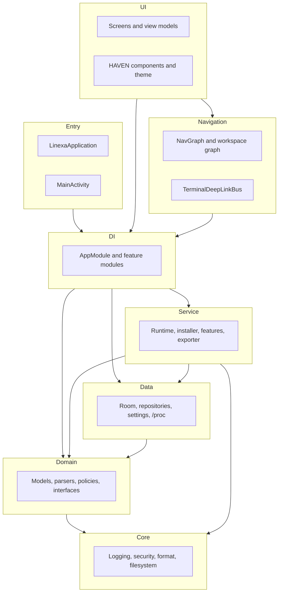

# Application Architecture

**Source locations:** `app/src/main/java/com/fem/linexa/{core,domain,data,service,ui,di,navigation}/`,
`app/src/main/java/com/fem/linexa/ui/screens/workspace/WorkspaceNavGraph.kt`

This document describes the application-level structure: package layering, dependency
injection, navigation, and the error-handling conventions that hold the layers together.
Runtime internals are covered in [`RUNTIME_ARCHITECTURE.md`](./RUNTIME_ARCHITECTURE.md);
persistence in [`DATA_AND_PERSISTENCE.md`](./DATA_AND_PERSISTENCE.md).

## 1. Layer roles

| Layer | Responsibility | Typical dependencies |
|---|---|---|
| `core` | Cross-cutting utilities: logging and diagnostics, archive and path security, formatting, filesystem write windows, locale helpers | Android and Kotlin standard library; a few runtime-type references for diagnostics |
| `domain` | Immutable models, parsers, policies, repository/provider interfaces, pure reducers | `core`; command-model types in `service.commands` used by `LauncherApp` |
| `data` | Room, SharedPreferences, `/proc` readers, Android-platform implementations | `domain`, `core` |
| `service` | Android services, PRoot process orchestration, RootFS installation, feature provisioners, exporters | `domain`, `data`, `core` |
| `ui` | Compose screens, HAVEN components and theme, view models | `domain`, `data`, `service` contracts, `di` |
| `di` | Hilt bindings and dispatcher seams | all layers |
| `navigation` | Navigation Compose host, tab transitions, terminal deep-link bus | `ui`, `di` |

The hard layering rule is enforced by `ImportBoundaryTest`: `domain` and `ui` must not
import `service.runtime.container` internals. The broader intent — domain depending only on
core, and UI reaching implementations only through DI — is a design convention. A small
number of legacy ports cross those boundaries and are documented at their call sites.

## 2. Dependency injection

`di/AppModule.kt` is the central Hilt module. It provides the runtime, installer,
persistence, settings, resource-monitor, clipboard, audio, GPU, wake-lock, and notification
seams. Feature-specific modules cover narrower surfaces such as device-info labels.

Important bindings:

- `ContainerRuntime` → `PRootContainerRuntime`
- `PtySessionFactory` → `TermuxPtySessionFactory`
- `ResourceMonitor` → `ProcResourceMonitor`
- `FileManager` → `WorkspaceFileManagerImpl`
- `RootFsInstaller` → `StagedRootFsInstaller`
- `WorkspaceDiskStore`, `RootfsInspector` → `WorkspaceFileManager`
- `AudioSink`, `HostClipboard`, `HostWakeLock` → Android implementations, with recording fakes
  used by tests

Constructor injection is used throughout. Tests substitute `FakeProot`, `RecordingWakeLock`,
`RecordingAudioSink`, `RecordingHostClipboard`, and `ProotRuntimeTestHarness` without
starting Android services.

`SessionCreationDispatcher` is a deliberate seam: production supplies the main-Looper
dispatcher because the vendored `TerminalSession` captures the constructing thread's Looper
and uses it for emulator writes. JVM tests supply a plain dispatcher.

## 3. Navigation

Navigation Compose uses a single activity:

- Three top-level destinations: `workspaces`, `activity`, and `settings`.
  `navigateHavenTab` saves the previous tab state, restores the target state, and avoids
  duplicate tab entries.
- Top-level tab transitions use a 90 ms simultaneous crossfade. Pushed destinations keep
  the library defaults.
- A nested `WorkspaceNavGraph` contains `SHORTCUTS`, `DESKTOP`, `PACKAGE_MANAGER`,
  `FILE_MANAGER`, and `TASK_MANAGER`. Moving between these screens does not start or stop
  the workspace runtime.
- The terminal is an overlay on `SHORTCUTS`, not a destination. `TerminalDeepLinkBus`
  carries requests to open or focus a terminal; the active terminal id is state in the
  workspace graph.
- Settings includes pushed destinations for About, Device & System Information, terminal
  layout, and terminal toolbar. Live host metrics are shown by Device & System Information
  and the workspace performance panel.
- Predictive back is enabled app-wide (`enableOnBackInvokedCallback="true"`). The back stack
  follows the visible hierarchy; there are no jump-home shortcuts.

## 4. Error handling

Linexa uses sealed result and state types rather than untyped booleans:

- `InstallResult` and `CommandResult` describe success, failure, and output.
- `WorkspaceStatus.Broken(reason)` persists a diagnosable failure state.
- UI states use `HEmpty`, `HLoading`, and `HError` from the HAVEN component set; retry
  actions keep the user on the current screen.
- Fail-open behavior is used for optional metadata and presentation: an unreadable optional
  value becomes `null`/empty and is surfaced as "unknown" rather than fabricated as zero.
- Fail-closed behavior is used where safety matters: archive validation rejects path
  traversal, zip-slip, symlink escape, and oversized decompression; an unreadable VNC
  password prevents the desktop from starting unauthenticated.

Blocking bridges (`runBlocking`) are confined to the SAF provider and RootFS fixup, where a
synchronous Android callback or install-time contract requires it. There is no `GlobalScope`
use.

## 5. State and persistence boundaries

- `WorkspaceMetadata` is both the Room entity and the domain model. It stores identity,
  status, distro information, runtime/terminal/desktop settings, feature toggles, and
  per-workspace attributes.
- `WorkspaceStatus` is a sealed interface: `Created`, `Importing(progress)`, `Installed`,
  `Ready`, `Broken(reason)`, `Repairing`, `Deleting`.
- Session and terminal state (`SessionManager`, `RuntimeState`, `TerminalState`,
  `WorkspaceHealthRegistry`) are runtime-only and reset on process start.
- The VNC password is stored in `WorkspaceMetadata.attributes` as an AES-GCM envelope under
  an AndroidKeyStore key. Legacy plaintext rows are rewritten at startup; the plaintext is
  revealed only in memory. See
  [`../features/SECURITY_AND_PERMISSIONS.md`](../features/SECURITY_AND_PERMISSIONS.md).

## 6. Dependency direction

## 7. Related documentation

- [`SYSTEM_ARCHITECTURE.md`](./SYSTEM_ARCHITECTURE.md) — modules, entry points, native packaging
- [`RUNTIME_ARCHITECTURE.md`](./RUNTIME_ARCHITECTURE.md) — PRoot, PTY, session lifecycle
- [`DATA_AND_PERSISTENCE.md`](./DATA_AND_PERSISTENCE.md) — Room, RootFS metadata
- [`../engineering/CODE_CONVENTIONS.md`](../engineering/CODE_CONVENTIONS.md) — naming and layering conventions
- [`../decisions/ADR_REGISTER.md`](../decisions/ADR_REGISTER.md) — architectural decisions
