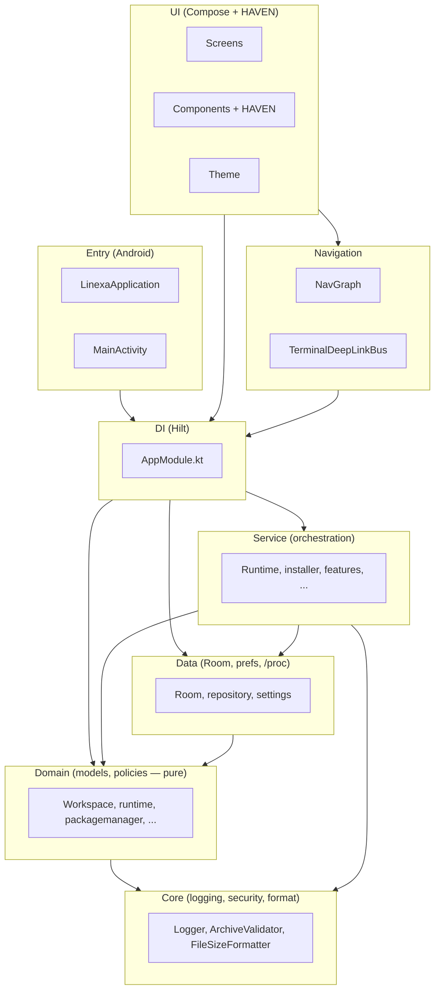

# Application Architecture

**Status:** Current — describes the implemented application architecture, verified against source.

**Project:** Linexa Linux Workspace (`com.fem.linexa`)

**Source locations:** `app/src/main/java/com/fem/linexa/{core,domain,data,service,ui,di,navigation}/`

---

## 1. Purpose

This document defines the application-level architecture: package layering, module boundaries, dependency injection, navigation, and the rules that keep layers separated. It is the authoritative reference for where each concern lives and how layers interact.

---

## 2. Scope

In scope:

- Layered package structure and role of each layer
- Hilt DI wiring and fakes
- Navigation Compose structure
- ArchUnit import-boundary rules and preservation pins
- Error-handling and fail-open philosophy

Out of scope:

- Runtime internals: [`architecture/RUNTIME_ARCHITECTURE.md`](./RUNTIME_ARCHITECTURE.md)
- Data/persistence schema: [`architecture/DATA_AND_PERSISTENCE.md`](./DATA_AND_PERSISTENCE.md)
- Feature behavior: [`features/`](../features/)

---

## 3. Current implementation status

| Area | Status | Evidence |
|---|---|---|
| Layered core/domain/data/service/ui/di/navigation | Implemented | source tree |
| ArchUnit import boundary | Implemented | `ImportBoundaryTest.kt` |
| Audit preservation pins | Implemented | `AuditPreservationPinsTest.kt` |
| Hilt DI via KSP | Implemented | `di/AppModule.kt` |
| Navigation Compose single-activity | Implemented | `navigation/NavGraph.kt` |
| Fail-open error handling | Implemented | sealed result/state types, documented catch sites |

---

## 4. Technical overview

### 4.1 Layer roles

| Layer | Responsibility | May depend on |
|---|---|---|
| `core` | Cross-cutting: logging, security, format | nothing |
| `domain` | Models, parsers, policies, interfaces | `core`; **plus known cross-layer ports** (`service.runtime.RuntimeBinder`, `service.runtime.WorkspaceFileManager`, `service.commands.*`) |
| `data` | Room, SharedPreferences, `/proc` readers, implementations | `domain`, `core` |
| `service` | Android/process-facing orchestration | `domain`, `data`, `core` |
| `ui` | Compose screens + HAVEN components | `domain`, `data`, `service` (through DI only) |
| `di` | Hilt bindings | all layers |
| `navigation` | Navigation Compose host, deep links | `ui`, `di` |

**Documented intent:** `domain` should depend only on `core`; `data` and `service` depend on `domain`; `ui` depends on `domain` + `data` + `service` through DI only.

**Measured state:** the intent is not fully enforced. Eleven `domain` files import `service.*` (chiefly `RuntimeBinder`, plus `WorkspaceFileManager` and `service.commands.*`), three `domain` files use Android/Room types, and two `core` files import `service`. `ImportBoundaryTest` currently enforces only "no `domain` → `service.runtime.container`" and "no `ui` → PRoot implementations". Tightening this requires either documenting the real rule or moving the ports into `domain` and extending ArchUnit; do not claim the stricter rule as implemented.

### 4.2 Dependency injection

`di/AppModule.kt` (~580 lines) provides ~19 `@Binds` and ~19 `@Provides`. Key bindings:

- `ContainerRuntime` → `PRootContainerRuntime`
- `PtySessionFactory` → `TermuxPtySessionFactory`
- `ResourceMonitor` → `ProcResourceMonitor`
- `FileManager` → `StagedRootFsInstaller`
- `AudioSink`, `HostClipboard`, `HostWakeLock` — narrow interfaces with `Recording*` fakes for tests

Constructor injection is used throughout, making fakes (`FakeProot`, `RecordingWakeLock`, `RecordingAudioSink`, `ProotRuntimeTestHarness`) possible. The `ImportBoundaryTest` ArchUnit rule (zero frozen exceptions) prevents `domain`/`ui` from importing `service.runtime.container` internals.

`AppModule.kt` is a single grab-bag of hand-built providers grouped by feature seam (logging, clipboard, audio, GPU, wake-lock, notifications). It is a navigation aid, not a behavioral defect; splitting into feature-scoped provider modules is a refactor candidate with no behavior change.

### 4.3 Navigation

Navigation Compose 2.7.7, single-activity host:

- Three permanent tabs: `workspaces`, `activity`, `settings` with `saveState`/`restoreState`, real back-stack entries, 90 ms crossfade (tuned from a documented jank analysis)
- Nested `WorkspaceNavGraph` with routes `SHORTCUTS`, `DESKTOP`, `PACKAGE_MANAGER`, `FILE_MANAGER`, `TASK_MANAGER`
- Terminal is an overlay, not a route (`TerminalDeepLinkBus`)
- Predictive back enabled app-wide in the manifest (`enableOnBackInvokedCallback="true"`)
- No "jump home" shortcuts; back hierarchy is truthful

### 4.4 Error handling

- Sealed result/state types (`InstallResult`, `CommandResult`, `WorkspaceStatus.Broken(reason)`)
- Typed UI states (`HEmpty`/`HLoading`/`HError`, "retry keeps you in place")
- Documented fail-open philosophy: failures return empty/default values and are surfaced in UI states; 322 broad `catch` sites and 191 `runCatching` calls, mostly documented
- Archive safety (`RealArchiveValidator`: path traversal, zip-slip, archive bomb) is a noted strength
- `runBlocking` appears at 3 production sites with justification comments (`RuntimeService.kt`, `RootfsFixupService.kt`, `LinexaDocumentsProvider.kt`); no `GlobalScope`

---

## 5. Mermaid: dependency direction

---

## 6. Important implementation details

- `AppModule.kt` binds `provideHostSystemInfoProvider` and `provideHostInfoRuntimeBridge` as `@Singleton`.
- The workspace lifecycle states are `Created`, `Importing(progress)`, `Installed`, `Ready`, `Broken(reason)`, `Repairing`, `Deleting` (`WorkspaceStatus` sealed interface).
- Room: one entity `WorkspaceMetadata`, `version = 1`, `exportSchema = true`, schema JSON committed. No migrations registered; plain `Room.databaseBuilder(...).build()`.
- `WorkspaceMetadata.attributes` holds per-workspace config. The VNC password is stored there as an AES-GCM/AndroidKeyStore envelope by `WorkspaceSecretAttributes`; it is revealed only in memory, and legacy plaintext rows are migrated at startup — see [`features/SECURITY_AND_PERMISSIONS.md`](../features/SECURITY_AND_PERMISSIONS.md).

---

## 7. Limitations and known issues

- No Room migrations: a schema bump requires a committed schema JSON + migration class; `fallbackToDestructiveMigration` must not be set.
- The documented `domain → core` dependency rule is not the measured rule; see §4.1.
- Eight files exceed 1,200 lines, led by `PRootContainerRuntime.kt` (2,743) and `GuestRootfsInitializer.kt` (2,398). Extracting them is a future refactor.
- `AppModule.kt` is large (~580 lines); splitting is a navigation-only refactor, not yet done.
- No `androidTest` instrumentation source set exists.
- On some Termux/Bionic hosts the default glibc-linked SQLite JDBC native must be overridden; see [`../engineering/BUILD_AND_DEVELOPMENT.md`](../engineering/BUILD_AND_DEVELOPMENT.md).

---

## 8. Related documentation

- [`architecture/SYSTEM_ARCHITECTURE.md`](./SYSTEM_ARCHITECTURE.md) — system architecture, module layout
- [`architecture/RUNTIME_ARCHITECTURE.md`](./RUNTIME_ARCHITECTURE.md) — PRoot runtime, PTY, session lifecycle
- [`architecture/DATA_AND_PERSISTENCE.md`](./DATA_AND_PERSISTENCE.md) — Room, schema, RootFS metadata
- [`decisions/ADR_REGISTER.md`](../decisions/ADR_REGISTER.md) — Keep/Fix/Refactor decisions per subsystem
- [`engineering/CODE_CONVENTIONS.md`](../engineering/CODE_CONVENTIONS.md) — naming, layering, documentation conventions
