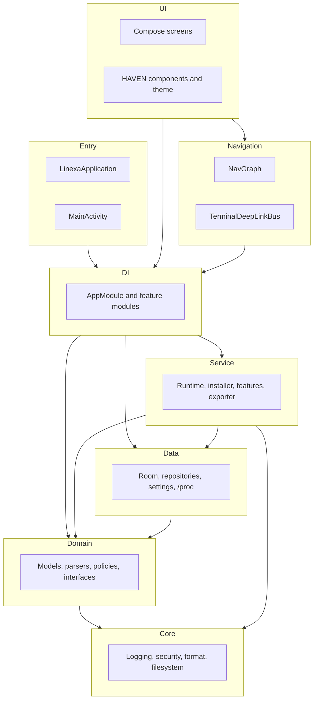

# System Architecture

**Source locations:** `app/src/main/java/com/fem/linexa/`, `app/build.gradle.kts`,
`settings.gradle.kts`, `app/src/main/AndroidManifest.xml`

This document describes the module layout, entry points, subsystem boundaries, dependency
direction, and packaging of the application. Feature behavior is covered in
[`features/`](../features/); runtime internals in
[`RUNTIME_ARCHITECTURE.md`](./RUNTIME_ARCHITECTURE.md); persistence in
[`DATA_AND_PERSISTENCE.md`](./DATA_AND_PERSISTENCE.md).

## 1. Purpose

Linexa is a single-application Android project with two vendored Gradle library modules. It
installs, imports, exports, and runs Linux root filesystems ("workspaces") inside isolated
PRoot containers on Android. Each workspace can run PTY-backed terminals and an optional
VNC/Web desktop, together with guest-side features such as audio, clipboard, notifications,
SSH, and GPU acceleration.

## 2. Modules

`settings.gradle.kts` declares three modules:

| Module | Purpose | License provenance |
|---|---|---|
| `:app` | Main application (`com.fem.linexa`): UI, runtime, DI, Room, package management | Linexa source, GPL-3.0-or-later |
| `:terminal-emulator` | Vendored Termux terminal-emulator library | Apache-2.0; see `terminal-emulator/PROVENANCE.md` |
| `:terminal-view` | Vendored Termux terminal-view library | Apache-2.0; see `terminal-view/PROVENANCE.md` |

The terminal modules provide the real PTY implementation used by the application.

## 3. Application entry points

- `LinexaApplication` (`@HiltAndroidApp`) — application class and Hilt entry point.
- `MainActivity` (`@AndroidEntryPoint`) — single-activity Compose host. Edge-to-edge and
  predictive back are enabled app-wide.
- `RuntimeService` — foreground service (`specialUse`) that owns container and terminal
  lifecycle for the entered workspace.
- `ImportService` — foreground service (`specialUse`) for workspace import.
- `DownloadService` — foreground service (`dataSync`) for RootFS downloads.
- `LinexaDocumentsProvider` — SAF `DocumentsProvider` exposing installed workspace rootfs
  trees and the shared storage mount, guarded by `MANAGE_DOCUMENTS`.

Manifest permissions: `INTERNET`, `ACCESS_NETWORK_STATE`, `FOREGROUND_SERVICE` plus the
`SPECIAL_USE` and `DATA_SYNC` subtypes, `POST_NOTIFICATIONS`, optional
`MANAGE_EXTERNAL_STORAGE`, `REQUEST_IGNORE_BATTERY_OPTIMIZATIONS`, and `WAKE_LOCK`.

`allowBackup="true"` is scoped by `backup_rules` and `data_extraction_rules`, which exclude
the Room database, the workspaces tree, logs, bootstrap files, and settings preferences.

## 4. Package layering

Source lives under `app/src/main/java/com/fem/linexa/`:

| Layer | Packages | Role |
|---|---|---|
| Entry | `LinexaApplication.kt`, `MainActivity.kt` | Android application and single-activity host |
| `core` | `format`, `logging`, `security`, `filesystem`, `i18n` | Cross-cutting utilities: formatting, diagnostic logging, archive validation, write windows, locale helpers |
| `domain` | `workspace`, `runtime`, `packagemanager`, `resource`, `settings`, `filemanager`, `hostinfo`, `network`, `distro`, `commands`, `attribution`, `whatsnew`, `launcher`, `version`, `terminal`, `security` | Models, parsers, policies, and repository/provider interfaces |
| `data` | `room`, `repository`, `settings`, `resource`, `hostinfo`, `network`, `security`, `version` | Room, SharedPreferences, `/proc`, and Android-platform implementations |
| `service` | `installer`, `rootfs`, `runtime` (including `bootstrap`, `container`, `desktop`, `features`, `graphics`, `hostinfo`, `pty`, `wakelock`), `exporter`, `importservice`, `distro`, `manager`, `workspace`, `workspaceconfig`, `commands` | Android- and process-facing orchestration |
| `ui` | `screens/*`, `components` (including `haven`), `theme` (including `haven`), `misc`, `i18n` | Compose screens and the HAVEN design system |
| `di` | `AppModule.kt`, `SessionCreationDispatcher.kt`, feature modules | Hilt bindings |
| `navigation` | `NavGraph.kt`, `TabTransition.kt`, `TerminalDeepLinkBus.kt` | Navigation Compose host and terminal overlay signaling |

The domain layer is intentionally mostly free of Android and Compose types. A few
cross-layer references remain: `LauncherApp` uses command-model types from
`service.commands`, and `core.logging.DebugCaptureGate` / `core.security.SecurityAudit`
reference runtime types. These ports are documented at their call sites rather than hidden.

## 5. Dependency direction

```
Entry --> DI
UI --> Navigation
UI --> DI
Navigation --> DI
DI --> Service / Data / Domain
Service --> Domain
Service --> Data
Data --> Domain
Domain --> Core
Service --> Core
```

`ImportBoundaryTest` enforces the hard rule that `domain` and `ui` must not import
`service.runtime.container` internals. Other layer relationships are conventions rather than
compiler-enforced rules; the UI consumes domain/service state and contracts directly while
Hilt supplies the implementations.



## 6. Dependency injection

Hilt is configured with KSP. `di/AppModule.kt` is the central binding module; feature-scoped
modules cover additional seams such as device-info labels. Constructor injection is used
throughout, which allows tests to substitute fakes such as `FakeProot`, `RecordingWakeLock`,
`RecordingAudioSink`, and `RecordingHostClipboard`.

Key bindings include:

- `ContainerRuntime` → `PRootContainerRuntime`
- `PtySessionFactory` → `TermuxPtySessionFactory`
- `ResourceMonitor` → `ProcResourceMonitor`
- `FileManager` → `WorkspaceFileManagerImpl`
- `RootFsInstaller` → `StagedRootFsInstaller`
- `WorkspaceDiskStore` / `RootfsInspector` → `WorkspaceFileManager`

## 7. Navigation

Navigation Compose uses a single-activity host:

- Three permanent tabs: `workspaces`, `activity`, `settings`. Tab state is saved and
  restored, and each tab keeps a real back stack.
- A nested workspace graph with `SHORTCUTS`, `DESKTOP`, `PACKAGE_MANAGER`,
  `FILE_MANAGER`, and `TASK_MANAGER` destinations.
- The terminal is an overlay on the workspace screen, not a navigation destination.
  `TerminalDeepLinkBus` carries focus/open requests.
- Predictive back is enabled in the manifest, and the back hierarchy has no "jump home"
  shortcuts.
- Top-level tab switches use a short simultaneous crossfade; pushed screens keep the
  Navigation Compose defaults.

## 8. Runtime and persistence boundaries

- `PRootContainerRuntime` owns per-(workspace, terminal) sessions, PRoot argv/environment
  construction (through `PRootLauncher`), bootstrap verification, PTY creation, and managed
  daemons.
- `RuntimeService` starts and binds `RuntimeBinder` and `WorkspaceSessionSupervisor`;
  `WorkspaceNavGraph` requests workspace start through the runtime view model.
- Room stores one entity, `WorkspaceMetadata`, at schema version 1. The exported schema is
  committed at `app/schemas/com.fem.linexa.data.room.LinexaDatabase/1.json`; no migrations
  are registered yet. See [`ROOM_MIGRATIONS.md`](../ROOM_MIGRATIONS.md) before changing the
  schema.
- Session and terminal state are runtime-only and reset when the app process dies. RootFS
  metadata and per-workspace configuration are file-backed and survive restarts.

## 9. Native binaries

PRoot, BusyBox, GNU tar, Zstandard, tmux, the loader, and their dependent libraries are
vendored in `app/src/main/jniLibs/` for `arm64-v8a` and `armeabi-v7a` only. There is no
x86_64 `libproot.so`, so x86_64 emulators cannot launch workspaces.

The binaries use the `lib__*__.so` naming required by AGP packaging and are remapped to
friendly names under `{filesDir}/bootstrap/{bin,lib}` at runtime. Exact versions, per-ABI
hashes, and the dependency closure are recorded in
[`app/src/main/jniLibs/BINARY-MANIFEST.md`](../../app/src/main/jniLibs/BINARY-MANIFEST.md).

## 10. Related documentation

- [`APPLICATION_ARCHITECTURE.md`](./APPLICATION_ARCHITECTURE.md) — package layering, DI, navigation
- [`RUNTIME_ARCHITECTURE.md`](./RUNTIME_ARCHITECTURE.md) — PRoot, PTY, session lifecycle
- [`DATA_AND_PERSISTENCE.md`](./DATA_AND_PERSISTENCE.md) — Room, RootFS metadata, install pipeline
- [`../engineering/BUILD_AND_DEVELOPMENT.md`](../engineering/BUILD_AND_DEVELOPMENT.md) — toolchain and build
- [`../decisions/ADR_REGISTER.md`](../decisions/ADR_REGISTER.md) — architectural decisions
