# System Architecture

**Status:** Current — describes the implemented architecture, verified against source.

**Project:** Linexa Linux Workspace (`com.fem.linexa`)

**Source locations:** `app/src/main/java/com/fem/linexa/` and subpackages; `app/build.gradle.kts`; `settings.gradle.kts`; `app/src/main/AndroidManifest.xml`

---

## 1. Purpose

Linexa is a single-module Android application (with two vendored Gradle library modules, `:terminal-emulator` and `:terminal-view`) that installs, imports, exports, and runs Linux root filesystems ("workspaces") inside isolated PRoot containers on Android. Each workspace runs a real PTY terminal, an optional VNC/Web desktop, and guest-side features (audio, clipboard, notifications, SSH, GPU).

This document is the authoritative system-architecture reference. It describes the module layout, entry points, subsystem boundaries, and the dependency direction enforced by tests.

---

## 2. Scope

In scope:

- Gradle module layout and ABI packaging
- Application entry points (Application, Activity, services)
- Layered package structure and the ArchUnit import boundary
- Dependency injection (Hilt) seam
- Navigation structure
- Native binary packaging (jniLibs)

Out of scope (covered elsewhere):

- Feature-level behavior: [`features/`](../features/)
- UI/UX design: [`design/`](../design/)
- Build toolchain details: [`engineering/BUILD_AND_DEVELOPMENT.md`](../engineering/BUILD_AND_DEVELOPMENT.md)
- Historical decisions: [`decisions/ADR_REGISTER.md`](../decisions/ADR_REGISTER.md)

---

## 3. Current implementation status

| Area | Status | Evidence |
|---|---|---|
| Single-module app (`:app`) | Implemented | `settings.gradle.kts` |
| Vendored terminal modules (`:terminal-emulator`, `:terminal-view`) | Implemented | `settings.gradle.kts`, `terminal-*/PROVENANCE.md` |
| Layered core/domain/data/service/ui/di/navigation | Implemented | source tree |
| ArchUnit import boundary (domain/ui must not import service.runtime internals) | Implemented | `app/src/test/.../architecture/ImportBoundaryTest.kt` |
| Hilt DI via KSP | Implemented | `di/AppModule.kt` |
| Navigation Compose single-activity host | Implemented | `navigation/NavGraph.kt` |
| PRoot-based container runtime | Implemented | `service/runtime/container/PRootContainerRuntime.kt` |
| Room persistence (1 entity, version 1, exported schema) | Implemented | `data/room/LinexaDatabase.kt` |

---

## 4. Technical overview

### 4.1 Gradle module layout

`settings.gradle.kts` declares three modules:

| Module | Purpose | License provenance |
|---|---|---|
| `:app` | Main application (`com.fem.linexa`) — UI, runtime, DI, Room, package management | Linexa source (GPL-3.0-or-later) |
| `:terminal-emulator` | Vendored Termux terminal-emulator library (Apache-2.0) | `terminal-emulator/PROVENANCE.md` |
| `:terminal-view` | Vendored Termux terminal-view library (Apache-2.0) | `terminal-view/PROVENANCE.md` |

The two terminal modules were vendored in 2026-08-29, replacing the GPL-3.0-only `terminal-lib` JitPack dependency.

### 4.2 Application entry points

- `LinexaApplication` (`@HiltAndroidApp`) — single application class, Hilt entry point
- `MainActivity` (`@AndroidEntryPoint`) — single-activity host; edge-to-edge enabled; predictive back opted in app-wide
- `RuntimeService` (foreground service, `specialUse`) — owns container/runtime lifecycle per workspace
- `ImportService` (foreground service, `specialUse`) — workspace import
- `DownloadService` (foreground service, `dataSync`) — RootFS download
- `LinexaDocumentsProvider` (SAF `DocumentsProvider`) — diagnostic rootfs browser, guarded by `MANAGE_DOCUMENTS`

Manifest permissions: `INTERNET`, `ACCESS_NETWORK_STATE`, `FOREGROUND_SERVICE` (+`SPECIAL_USE`, `+DATA_SYNC`), `POST_NOTIFICATIONS`, `MANAGE_EXTERNAL_STORAGE` (opt-in), `REQUEST_IGNORE_BATTERY_OPTIMIZATIONS`, `WAKE_LOCK`.

`allowBackup="true"` scoped by `backup_rules`/`data_extraction_rules` excluding the Room DB, workspaces tree, logs, bootstrap, and settings preferences.

### 4.3 Layered package structure

Source lives under `app/src/main/java/com/fem/linexa/`:

| Layer | Packages | Role |
|---|---|---|
| Entry | `LinexaApplication.kt`, `MainActivity.kt` | Single-activity host |
| `core` | `format`, `logging`, `security` | Cross-cutting: logger/log sink, archive validator, security audit, file size formatter |
| `domain` | `workspace`, `runtime`, `packagemanager`, `resource`, `settings`, `filemanager`, `hostinfo`, `network`, `distro`, `commands`, `attribution`, `whatsnew`, `launcher`, `version` | Mostly pure models, parsers, policies, interfaces (e.g. `WorkspaceRepository`, `ResourceMonitor`, `PackageProvider`) |
| `data` | `room`, `repository`, `settings`, `resource`, `hostinfo`, `network`, `version` | Implementations backed by Room, SharedPreferences, `/proc` readers |
| `service` | `installer`, `rootfs`, `runtime` (+`bootstrap`, `container`, `desktop`, `features`, `graphics`, `hostinfo`, `pty`, `wakelock`), `exporter`, `importservice`, `distro`, `manager`, `workspace`, `workspaceconfig`, `commands` | Android/process-facing orchestration |
| `ui` | `screens/*`, `components` (+`haven`), `theme` (+`haven`), `misc` | Compose screens + HAVEN design system |
| `di` | `AppModule.kt`, `SessionCreationDispatcher.kt` | Hilt bindings (~19 `@Binds`, ~19 `@Provides`) |
| `navigation` | `NavGraph.kt`, `TerminalDeepLinkBus.kt` | Navigation Compose host |

### 4.4 Dependency direction (enforced by ArchUnit)

```
Entry --> DI
UI --> Nav
UI --> DI
Nav --> DI
DI --> Service
DI --> Data
DI --> Domain
Service --> Domain
Service --> Data
Data --> Domain
Domain --> Core
Service --> Core
```

`domain` and `ui` must not import `service.runtime.container` internals. The `ImportBoundaryTest` ArchUnit rule runs with zero frozen exceptions. `AuditPreservationPinsTest` additionally pins audited runtime behavior (real PTY architecture, `/proc`+`/sys`+`/dev` binds, `--kill-on-exit`, `-0` fake root, `--link2symlink`, L2S rewriter relative targets, archive validation, vendored patches).

### 4.5 Mermaid: layered architecture

```mermaid
graph TD
    subgraph Entry ["Entry (Android)"]
        LA[LinexaApplication @HiltAndroidApp]
        MA[MainActivity @AndroidEntryPoint]
    end

    subgraph UI ["UI layer (Compose + HAVEN)"]
        US[Screens]
        UC[Components + HAVEN]
        UT[Theme + HavenTokens]
    end

    subgraph Nav ["Navigation"]
        NG[NavGraph / WorkspaceNavGraph]
        TDB[TerminalDeepLinkBus]
    end

    subgraph DI ["Dependency Injection (Hilt)"]
        AM[AppModule.kt]
        SCD[SessionCreationDispatcher]
    end

    subgraph Service ["Service layer (process orchestration)"]
        SR[Runtime: container, pty, session, bootstrap, wakelock]
        SI[Installer: StagedRootFsInstaller, InstallRecoveryManager]
        SRFS[RootFS: profile, inspector, metadata]
        SF[Features: audio, clipboard, notifications, desktop, gpu]
        SE[Exporter, ImportService, Distro, Manager]
    end

    subgraph Data ["Data layer (Room, SharedPreferences)"]
        DR[Room: LinexaDatabase, WorkspaceDao]
        DRepo[Repository: WorkspaceRepositoryImpl]
        DSet[SettingsRepositoryImpl SharedPreferences]
        DRes[Resource: ProcResourceMonitor, AndroidProcessSignals]
    end

    subgraph Domain ["Domain layer (models, policies, interfaces — pure)"]
        DW[Workspace: WorkspaceRepository, WorkspaceMetadata, WorkspaceStatus]
        DRt[Runtime: RuntimeState, TerminalState, CommandResult]
        DPkg[PackageManager: providers, coordinator, parsers]
        DRes2[Resource: ProcessTree, ResourceMonitor]
        DSet2[Settings: SettingsRepository, ColorTheme, ThemeMode]
        DFM[FileManager: FileManager interface]
    end

    subgraph Core ["Core cross-cutting"]
        CL[Logging: Logger, LogSink, DiagnosticLogManager]
        CS[Security: ArchiveValidator, RealArchiveValidator, SecurityAudit]
        CF[Format: FileSizeFormatter]
    end

    Entry --> DI
    UI --> Nav
    UI --> DI
    Nav --> DI
    DI --> Service
    DI --> Data
    DI --> Domain
    Service --> Domain
    Service --> Data
    Data --> Domain
    Domain --> Core
    Service --> Core
```



**Principle:** Domain depends on nothing but Core. Data and Service depend on Domain. UI depends on Domain + Data + Service through DI only.

---

## 5. Important implementation details

- Native binaries (PRoot, busybox, tar, zstd, tmux, loader, dependency libs) are vendored in `app/src/main/jniLibs/` for `arm64-v8a` and `armeabi-v7a` only. There is **no x86_64 `libproot.so`**, so x86_64 emulators cannot launch workspaces. See [`app/src/main/jniLibs/BINARY-MANIFEST.md`](../../app/src/main/jniLibs/BINARY-MANIFEST.md).
- PRoot is termux-lineage v5.1.107.89 with Linexa patches 0001–0004 (see `jniLibs/proot-build/BUILD-NOTES.md`).
- The terminal stack is the vendored Apache-2.0 Termux `terminal-emulator`/`terminal-view` (a real PTY via `forkpty`-equivalent native code), not the removed GPL-3.0 `terminal-lib`.
- Room database is version 1, one entity (`WorkspaceMetadata`), schema exported and committed at `app/schemas/.../1.json`. No migrations are registered yet.
- `isMinifyEnabled = false` for both debug and release.

---

## 6. Dependencies and interactions

- Hilt DI (`AppModule.kt`) wires `ContainerRuntime` → `PRootContainerRuntime`, `PtySessionFactory` → `TermuxPtySessionFactory`, `ResourceMonitor` → `ProcResourceMonitor`, `FileManager` → `StagedRootFsInstaller`, plus supervisors for notifications, clipboard, audio, GPU, wake-lock.
- `RuntimeService` starts and binds `RuntimeBinder` and `WorkspaceSessionSupervisor`; `WorkspaceNavGraph` triggers `startWorkspace()`.
- The PRoot container runtime owns per-(workspace, terminal) session bookkeeping, PRoot argv/env construction (delegated to `PRootLauncher`), bootstrap layout verification, PTY session creation, and daemon management.

---

## 7. Limitations and known issues

- No Room migrations: a schema version bump without a migration crashes existing installs on open. The migration policy is in [`ROOM_MIGRATIONS.md`](../ROOM_MIGRATIONS.md).
- Runtime, terminal, desktop, and RootFS-import flows still need on-device verification across the supported Android versions; see [`engineering/TESTING_STRATEGY.md`](../engineering/TESTING_STRATEGY.md) and [`features/TERMINAL_AND_LINUX_RUNTIME.md`](../features/TERMINAL_AND_LINUX_RUNTIME.md).
- Builds require JDK 17 and an Android SDK with platform 34; see [`engineering/BUILD_AND_DEVELOPMENT.md`](../engineering/BUILD_AND_DEVELOPMENT.md).

---

## 8. Related documentation

- [`architecture/APPLICATION_ARCHITECTURE.md`](./APPLICATION_ARCHITECTURE.md) — package layering and boundary rules
- [`architecture/RUNTIME_ARCHITECTURE.md`](./RUNTIME_ARCHITECTURE.md) — PRoot runtime, PTY, session lifecycle
- [`architecture/DATA_AND_PERSISTENCE.md`](./DATA_AND_PERSISTENCE.md) — Room, schema, RootFS metadata
- [`decisions/ADR_REGISTER.md`](../decisions/ADR_REGISTER.md) — Keep/Fix/Refactor decisions per subsystem
- [`engineering/BUILD_AND_DEVELOPMENT.md`](../engineering/BUILD_AND_DEVELOPMENT.md) — toolchain and build commands
